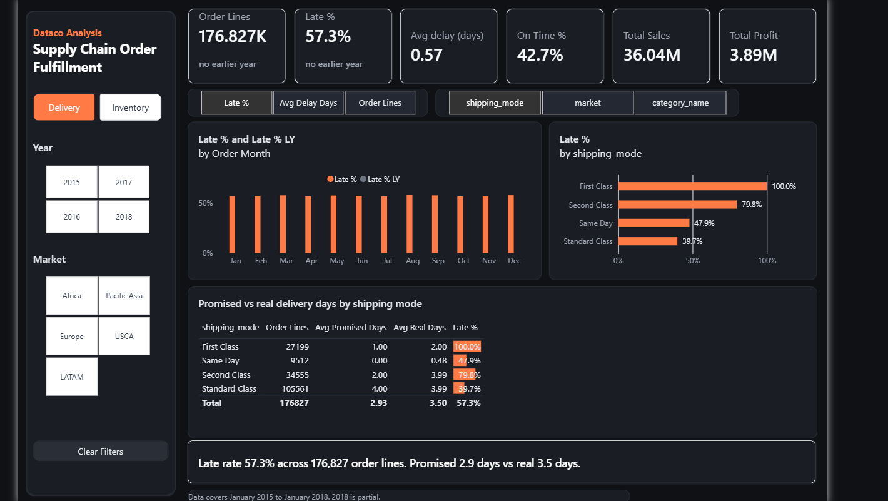
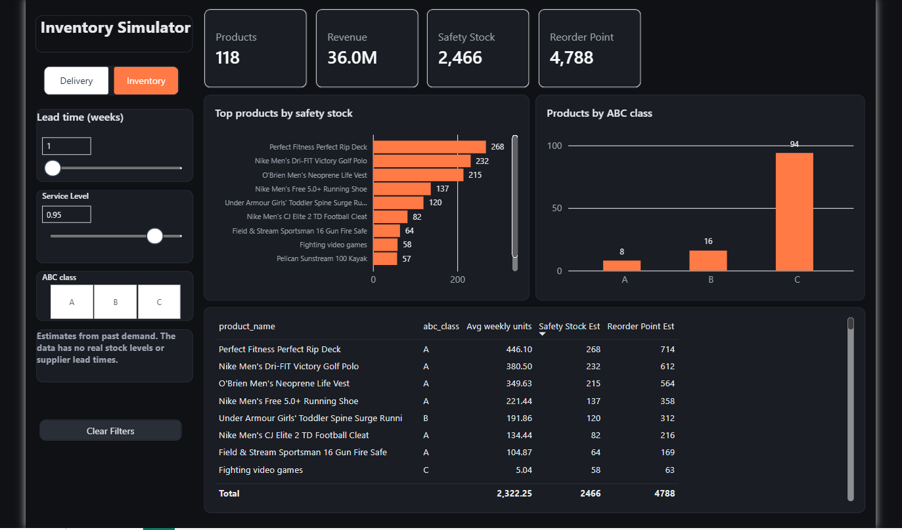

# Supply Chain Order Fulfillment & Inventory Optimization

I analysed order delivery and stock control on the public DataCo Smart Supply Chain dataset, using Python, MySQL and Power BI. It is a portfolio project on a public dataset, so the business scenario is simulated and not a real company's work.

## Questions I wanted to answer
1. Why are orders delivered late, and where? I looked at shipping mode, market, region, product category, product and month, and at how many days late the late lines are.
2. Which products need tighter stock control? I looked at revenue by product (ABC analysis), weekly demand, safety stock and reorder point.

## What I found
- **57.3% of order lines were delivered late.** That is 176,827 lines after removing canceled orders. On average a line arrived **0.57 days** after the promised date (3.50 real days against 2.93 promised).
- **Shipping mode matters, location does not.** Late % was **100%** for First Class, **79.8%** for Second Class, **47.9%** for Same Day and **39.7%** for Standard Class. The five markets were all close to each other (**56.9% to 57.6%**).
- **The reason is the promise.** Each mode has a fixed promised time: 1 day for First Class, 2 for Second Class, 0 for Same Day and 4 for Standard Class. First Class promises 1 day and takes 2 every time, so every line is late. So **late % shows how realistic each promise is, not which carrier is worse.**
- ANOVA (F = 22,848.34) and Kruskal-Wallis (H = 40,944.79) both give **p < 0.001**. **Shipping mode explains about 23% to 28% of the variation in delay.** Part of that is built into the data, because delay is measured against the fixed promise.
- **Revenue sits in a few products.** **8 of 118 products** (class A) bring **about 85% of the revenue** (30.5M of 36.0M). Class B has 16 products and class C has 94.
- With a 1 week lead time and a 95% service level, my estimate for all products is **2,466 units of safety stock** and a **reorder point of 4,788**. At a 99% service level the safety stock is **3,487**.

## Dashboard
Page 1, Delivery Explorer:



Page 2, Inventory Simulator. The lead time and service level sliders change the estimates:



## Data
DataCo Smart Supply Chain for Big Data Analysis, from Mendeley Data (licence CC BY 4.0): https://data.mendeley.com/datasets/8gx2fvg2k6

The raw file has 180,519 order lines (one row per product in an order) and 53 columns, from January 2015 to January 2018. I did not upload the data files (see How to run).

## How I did it
1. **Cleaning (Python, pandas):** fixed the encoding and the date format, removed hidden spaces, kept 26 of the 53 columns, and added `delay_days`, `is_late` and `is_canceled`. The clean file has 180,519 rows and 29 columns.
2. **Database (MySQL 8):** loaded the clean file into a staging table, then split it into four tables: `customers`, `products`, `orders` and `shipping`, with primary and foreign keys.
3. **Validation (SQL):** checked the loaded data with row counts, totals, NULLs, duplicates and logic checks.
4. **Delivery analysis (SQL):** late % by shipping mode, market, region, category, product and month. Canceled lines are excluded.
5. **Statistics (Python):** tested the difference between shipping modes with ANOVA and Kruskal-Wallis.
6. **Inventory analysis (SQL):** ABC analysis of revenue, then safety stock and reorder point estimates.
7. **Dashboard (Power BI):** built a 2 page dashboard on the MySQL tables and checked its numbers against my SQL results.

## What to keep in mind
- The data has no real stock levels and no supplier lead times. The safety stock and reorder points are estimates from past demand and an assumed lead time of 1 week.
- Order volume falls by about 60% from October 2017, and 2018 has only January. Those months rest on fewer lines.
- The `Shipping canceled` label (7,754 lines) is 3,692 canceled orders plus 4,062 suspected-fraud orders. I kept the suspected-fraud lines in the delivery numbers. Without them the late rate moves from 57.28% to 57.29%.
- Weeks with no sales count as zero demand, which makes products that sell in short bursts look more variable.
- These results show a link between mode and delay, not a proven cause.

## Files
```
notebooks/   data cleaning, statistics and charts
sql/         create and load tables, validation, order fulfillment, inventory
dashboard/   supply_chain_project_dashboard.pbix
images/      dashboard screenshots
```

## How to run
1. Download the dataset from the link above and put `DataCoSupplyChainDataset.csv` in a folder.
2. Open the cleaning notebook in Google Colab, change the folder path in the first cell, and run it. It saves `clean_orders.csv`.
3. In MySQL 8, run `03_create_tables.sql`. Copy `clean_orders.csv` into the folder MySQL allows, then run `03_load_tables.sql`.
4. Run the SQL scripts 04 to 06 and the statistics notebook.
5. Open the `.pbix` file in Power BI Desktop and point it to your MySQL database.

## Author
[Your name] | [LinkedIn] [https://www.linkedin.com/in/tama-talukder/]
